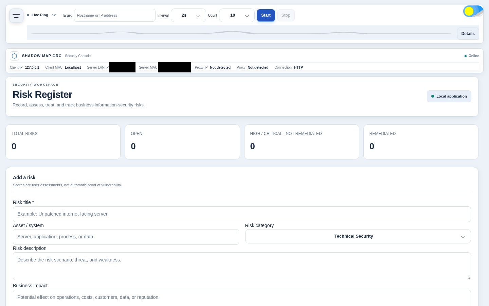

# Shadow Map GRC

Shadow Map GRC is a local security assessment and Governance, Risk, and Compliance (GRC) application built with Python, Flask, and SQLite.

It brings security scanning, findings review, risk tracking, and ISO/IEC 27001:2022 control traceability together in one application.

## Download Shadow Map GRC

Download the project before installing and running it.

### Method 1: Download ZIP (Recommended for beginners)

1. Open the [Shadow Map GRC GitHub repository](https://github.com/xITACHIxUCHIHAx/shadow-map-grc-v2).
2. Click **Code**.
3. Select **Download ZIP**.
4. Extract the downloaded ZIP file.
5. Open a terminal or command prompt inside the extracted project folder.

### Method 2: Clone using Git

**Windows (PowerShell or Command Prompt):**

    git clone https://github.com/xITACHIxUCHIHAx/shadow-map-grc-v2.git
    cd shadow-map-grc-v2

**macOS (Terminal):**

    git clone https://github.com/xITACHIxUCHIHAx/shadow-map-grc-v2.git
    cd shadow-map-grc-v2

**Linux (Terminal):**

    git clone https://github.com/xITACHIxUCHIHAx/shadow-map-grc-v2.git
    cd shadow-map-grc-v2

To update an existing Git clone later:

    git pull

## Features

- Dashboard and scan history
- Unified security assessments
- Nmap network and service scanning
- LAN Monitor and local network discovery
- Cross-platform network interface and gateway detection (Linux, Windows, and macOS)
- Web security assessment and read-only discovery
- OWASP ZAP integration and proxy management
- Firewall assessment
- Threat intelligence and vulnerability information
- Combined findings and findings review
- Risk register and custom detection rules
- ISO/IEC 27001:2022 control traceability
- PDF reports and CSV exports
- Records management
- Scan progress monitoring

Available capabilities depend on configuration, installed tools, network access, and permissions.

## Application Screenshots

### Dashboard

The dashboard provides an overview of assessment activity, findings, and risk treatment.


### Unified Scan

Run and monitor unified security assessments from one workspace.


### Risk Register

Record, assess, track, and manage information-security risks.



## Requirements

Before starting Shadow Map GRC, install the following:

| Requirement | Purpose |
|---|---|
| Python 3.11 or newer | Runs the application |
| pip | Installs Python dependencies |
| Nmap | Optional; enables network scanning |
| Java 17 or newer | Optional; required only for OWASP ZAP |
| Internet connection | Required for initial dependency installation |

Python dependencies are listed in `requirements.txt`. The launch scripts install them automatically.

## 1. Install Python

Download Python only from the official Python website:

**Official download:** https://www.python.org/downloads/

Choose the instructions for your operating system below.

### Windows

1. Open https://www.python.org/downloads/windows/
2. Download a current Python 3 Windows installer.
3. Run the installer.
4. Ensure the Python Launcher (`py`) is installed. It is required by the Windows launch script.
5. Select the option to add Python to PATH if available.
6. Complete the installation.

Open a new Command Prompt and verify:

```cmd
py --version
py -m pip --version
```

Both commands should display version information.

If Windows cannot find `py`, rerun the Python installer and ensure the Python Launcher is installed.

### macOS

1. Open https://www.python.org/downloads/macos/
2. Download the macOS installer for a current Python 3 release.
3. Open the downloaded installer package.
4. Follow the installation instructions.
5. Open a new Terminal window.

Verify the installation:

```bash
python3 --version
python3 -m pip --version
```

Alternatively, Python can be installed using Homebrew:

```bash
brew install python
```

Homebrew: https://brew.sh/

### Linux

Python 3 is available through the package manager of most Linux distributions.

**Debian, Ubuntu, and Kali Linux:**

```bash
sudo apt update
sudo apt install -y python3 python3-pip python3-venv
```

**Fedora:**

```bash
sudo dnf install -y python3 python3-pip
```

**Arch Linux:**

```bash
sudo pacman -S python python-pip
```

For other distributions, use the distribution's official package manager or Python installation instructions.

Verify the installation:

```bash
python3 --version
python3 -m pip --version
```

If your distribution separates the virtual environment package, install it before continuing.

## 2. Download the Project

Download or clone the Shadow Map GRC project and extract it if you downloaded a ZIP archive.

Open a terminal or Command Prompt inside the extracted project directory.

The project root should contain files such as:

- `app.py`
- `config.py`
- `requirements.txt`
- `README.md`
- `scripts/`

## 3. Install Nmap

Nmap is optional for application startup but required for network scanning.

Official download page: https://nmap.org/download.html

The launchers can attempt to install Nmap automatically:

- **Linux:** Offers installation through supported package managers (apt-get, dnf, pacman, or zypper).
- **macOS:** Offers installation using Homebrew if available.
- **Windows:** Refreshes winget sources, checks the package, and offers installation if available.

If automatic installation is unavailable or unsuccessful, install Nmap manually using its official download instructions.

After installation, open a new terminal if necessary and verify:

```bash
nmap --version
```

On Windows, run:

```cmd
nmap --version
```

## 4. Start Shadow Map GRC

Run the appropriate launcher from the project root directory.

### Kali Linux and other Linux distributions

```bash
bash scripts/start-linux.sh
```

The Linux launcher:

- Requires Python 3.11 or newer.
- Checks for Python virtual environment support.
- Offers to install Nmap if it is missing and a supported package manager is available.
- Offers to install Java 17 or newer if it is missing.
- Treats Nmap and Java as optional for application startup.
- Creates a virtual environment in the project directory.
- Upgrades pip and installs dependencies from `requirements.txt`.
- Starts the application.

Nmap enables network scanning. Java enables OWASP ZAP integration. Package installation depends on the available package manager, network access, and permissions.

### macOS

```bash
bash scripts/start-macos.sh
```

The macOS launcher:

- Requires Python 3.11 or newer.
- Offers to install Nmap using Homebrew if it is missing.
- Offers to install Java 17 or newer if it is missing.
- Treats Nmap and Java as optional for application startup.
- Creates a virtual environment.
- Installs dependencies from `requirements.txt`.
- Starts the application.

Nmap enables network scanning. Java enables OWASP ZAP integration. If Homebrew is unavailable, install missing tools manually.

### Windows

Open Command Prompt in the project root directory and run:

```cmd
scripts\start-windows.bat
```

The Windows launcher:

- Requires Python 3.11 or newer and the Python Launcher (`py`).
- Offers to install Nmap using winget after refreshing sources and checking the package.
- Offers to install Java 17 or newer for OWASP ZAP.
- Treats Nmap and Java as optional for application startup.
- Creates a virtual environment.
- Installs dependencies from `requirements.txt`.
- Starts the application.

Nmap enables network scanning. Java enables OWASP ZAP integration. If winget installation is unavailable or fails, install the tools manually.


### Java and OWASP ZAP Troubleshooting

OWASP ZAP requires Java 17 or newer.

Verify the Java installation:

- Linux and macOS: run `java -version` and `which java`.
- Windows: run `java -version` and `where.exe java`.

If Java is installed but Shadow Map GRC cannot detect it:

- Confirm that the installed runtime is Java 17 or newer.
- Confirm that the Java executable is available through `PATH`.
- Set `JAVA_HOME` to the Java installation directory if necessary.
- Restart Shadow Map GRC after changing environment variables.
- If multiple Java versions are installed, ensure the intended executable is selected.

Java is optional for application startup. OWASP ZAP integration requires a compatible Java runtime and ZAP installation.

### Nmap OS Detection Permissions

Nmap network scanning and Nmap OS detection have different privilege requirements. OS detection uses privileged packet operations and may not work when the application is running without the required permissions.

- **Linux:** Shadow Map GRC uses the restricted `shadow-map-nmap-os-helper` through `sudo -n` for OS detection. The helper must be installed and correctly permitted. Do not replace this with unrestricted sudo access.
- **macOS:** Nmap OS detection requires Shadow Map GRC to run with root privileges. Close the application and restart it from an appropriately privileged terminal when this feature is needed.
- **Windows:** Nmap OS detection requires an elevated Administrator session. Close Shadow Map GRC and restart the launcher using **Run as administrator**. Npcap must also be installed and operational.

If OS detection is unavailable, ordinary network scanning may still work. Do not run the application with elevated privileges unless the specific assessment feature requires it.

## 5. Python Dependencies and Manual Setup

The launch scripts automatically create a virtual environment and install the packages listed in `requirements.txt`.

If you prefer to perform the Python setup manually, use the following commands.

**Linux and macOS:**

```bash
python3 -m venv venv
source venv/bin/activate
python -m pip install --upgrade pip
python -m pip install -r requirements.txt
```

**Windows Command Prompt:**

```cmd
py -3 -m venv venv
venv\Scripts\activate
python -m pip install --upgrade pip
python -m pip install -r requirements.txt
```

After manual installation, start the application with:

```bash
python app.py
```

On Windows, use the activated virtual environment in Command Prompt before running the command.

## 6. Open the Application

After the launcher starts successfully, open:

http://127.0.0.1:5000

Keep the terminal open while using the application.

Press `Ctrl+C` in the terminal to stop it.

The application binds to localhost by default. Do not expose it to an untrusted network without reviewing and securing its configuration.

## Database and Records

The application uses SQLite. The default database is stored at:

```text
data/shadow_map.db
```

### MITRE ATT&CK Catalogue

When Shadow Map GRC is started using `python app.py` or the documented launch scripts, a background worker checks the official MITRE Enterprise ATT&CK release index and imports the catalogue when the local database is empty or outdated.

- An internet connection is required for the initial catalogue download and subsequent update checks.
- After a successful check, the worker checks for updates every 24 hours.
- If synchronization fails, it retries after 15 minutes.
- The imported catalogue is stored in the local SQLite database.

Catalogue synchronization runs in the background and does not require a manually downloaded database file.

Assessment records, findings, and exported reports may contain sensitive information. Protect the database and backups, and review exported files before sharing them.

## Project Structure

- `app.py` - Flask application and routes
- `config.py` - Application configuration
- `data/` - Application data directory
- `grc/` - Governance, risk, and compliance logic
- `scanner/` - Security assessment and scanning modules
- `reporting/` - Reporting functionality
- `scripts/` - Operating-system launchers
- `static/` - Static assets
- `templates/` - HTML templates
- `tests/` - Automated tests
- `requirements.txt` - Python dependencies

## Development Checks

Create and activate a virtual environment and install the runtime dependencies as described in the manual setup instructions.

Install the test dependency:

```bash
python -m pip install pytest
```

Run the automated test suite with:

```bash
python -m pytest
```

## Responsible Use

Only assess systems and applications that you own or have explicit permission to test. Follow applicable laws, authorization boundaries, and organizational policies.

Review findings before treating them as confirmed vulnerabilities. Scanner output is assessment evidence, not a guarantee that a system is secure or insecure.

ISO/IEC 27001:2022 mappings are provided to support assessment and traceability. They do not constitute certification or an independent compliance audit.

## Limitations

- Nmap OS detection requires platform-specific elevated privileges and may be unavailable during an ordinary application session.
- Windows OS detection requires Administrator privileges and Npcap.
- Linux OS detection depends on the restricted Nmap helper being installed and permitted.
- macOS OS detection requires root privileges.
- Results depend on installed tools, network access, target configuration, and permissions.
- Some integrations require separate installation or configuration.
- OWASP ZAP requires Java 17 or newer.
- Automatic installation of system tools depends on the operating system, package manager, network availability, and permissions.
- The application is intended for local use by default; deployment in a shared or production environment requires additional security review.

## License

This project is licensed under the MIT License. See the [LICENSE](LICENSE) file for details.
