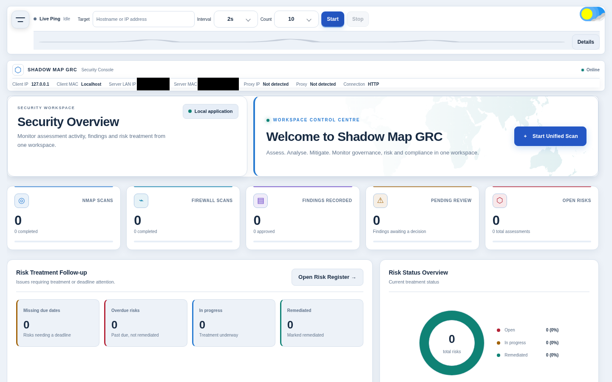
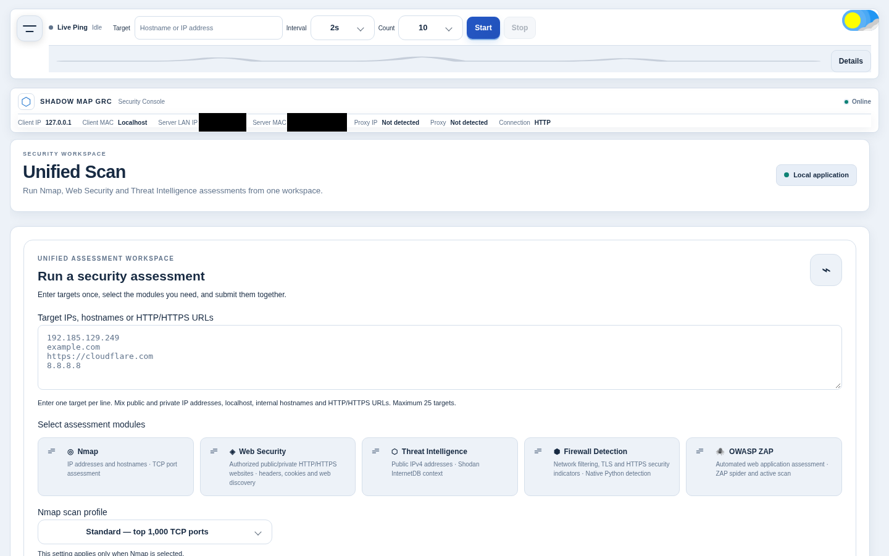

# Shadow Map GRC

**Security Assessment and Governance, Risk & Compliance Platform**

Shadow Map GRC is a Flask-based application that combines security assessment, risk management and GRC documentation in one platform.

| Information | Details |
|---|---|
| Project | Shadow Map GRC |
| Author | [xITACHIxUCHIHAx](https://github.com/xITACHIxUCHIHAx) |
| License | MIT |
| Technology | Python, Flask, SQLite |
| Deployment | Docker and Docker Compose |

## Screenshots

### Dashboard


### Unified Scan


### Risk Register


## Features

- Unified security assessments
- Nmap network and service scanning
- LAN Monitor
- Web Security and Wapiti integration
- OWASP ZAP integration
- Firewall assessment
- Threat Intelligence
- Findings Review and Risk Register
- Custom Rules
- ISO/IEC 27001:2022 control traceability
- PDF reports and CSV exports
- Scan history and Records Management

## Requirements

- Windows, macOS or Linux/Kali
- Docker and Docker Compose
- Internet connection for the initial Docker image pull
- Sufficient disk space for Docker images and application data

The supplied Docker image includes Python, Nmap, Java 21 and OWASP ZAP 2.17.0.

The prebuilt image is available on Docker Hub:

```bash
docker pull xitachixuchihax/shadow-map-grc:latest
```

The startup scripts automatically pull the latest published image before starting or restarting the application.

## Installing Git

Git is required to clone the Shadow Map GRC repository.

### Windows

```powershell
winget install --id Git.Git -e --source winget
```

Official installer: https://git-scm.com/downloads/win

### Linux

**Ubuntu / Debian / Kali**
```bash
sudo apt update && sudo apt install git -y
```

**Fedora**
```bash
sudo dnf install git -y
```

**RHEL / CentOS**
```bash
sudo yum install git -y
```

**Arch Linux / Manjaro**
```bash
sudo pacman -S git
```

**openSUSE**
```bash
sudo zypper install git
```

**Alpine Linux**
```bash
sudo apk add git
```

### macOS

```bash
brew install git
```

Alternatively: `xcode-select --install`

### Other Operating Systems

https://git-scm.com/install

### Verify Git Installation

```bash
git --version
```

### Clone Shadow Map GRC

```bash
git clone https://github.com/xITACHIxUCHIHAx/shadow-map-grc.git
```

## Installation

### 1. Download the project

Clone the repository:

```bash
git clone https://github.com/xITACHIxUCHIHAx/shadow-map-grc.git
cd shadow-map-grc
```

Alternatively, download the ZIP from GitHub and extract it.

### 2. Install Docker

Install Docker for your operating system:

- [Windows – Docker Desktop](https://docs.docker.com/desktop/setup/install/windows-install/)
- [macOS – Docker Desktop](https://docs.docker.com/desktop/setup/install/mac-install/)
- [Linux – Docker Engine](https://docs.docker.com/engine/install/)

For Kali Linux, follow the Docker Debian installation instructions appropriate to your system.

Start Docker Desktop on Windows/macOS.

On Linux:

```bash
sudo systemctl enable --now docker
```

Verify installation:

```bash
docker --version
docker compose version
```

### 3. Configure the application

**Important:** Run all commands in this section inside the Shadow Map GRC project root directory — the folder containing `docker-compose.yml`, `Dockerfile` and `.env.example`.

If you are not already in the project directory:

**Linux/macOS:**

```bash
cd ~/shadow-map-grc
```

**Windows PowerShell:**

```powershell
cd C:\path\to\shadow-map-grc
```

Replace the example Windows path with your actual project location.

**Create the `.env` file:**

Linux/macOS:

```bash
cp .env.example .env
```

Windows PowerShell:

```powershell
Copy-Item .env.example .env
```

**Generate a secure secret:**

Linux/macOS:

```bash
python3 -c "import secrets; print(secrets.token_hex(32))"
```

Windows PowerShell:

```powershell
python -c "import secrets; print(secrets.token_hex(32))"
```

Copy the generated value.

**Open `.env` in a text editor:**

Linux:

```bash
nano .env
```

macOS:

```bash
open -e .env
```

Windows:

```powershell
notepad .env
```

Replace the example value with your generated secret:

```env
SHADOW_MAP_SECRET_KEY=paste-your-generated-secret-here
```

Save the file and close the editor.

**Important:**
- `.env` must be in the project root, alongside `docker-compose.yml`.
- Do not create it in another directory.
- Do not upload `.env` to GitHub.
- Keep your secret private.

### 4. Start Shadow Map GRC

Run the command from the project root directory.

**Linux:**

```bash
bash scripts/grc start
```

**macOS:**

```bash
bash scripts/grc start
```

**Windows PowerShell:**

```powershell
.\scripts\grc.ps1 start
```

The first startup downloads the published Docker image. This may take some time depending on your internet connection.

### 5. Open the application

Once the container has started, open:

**http://127.0.0.1:5000**

Health check:

**http://127.0.0.1:5000/health**

Expected response:

```json
{"status":"ok"}
```

## Management Commands

Run these commands from the project root.

| Action | Linux/macOS | Windows PowerShell |
|---|---|---|
| Start | `bash scripts/grc start` | `.\scripts\grc.ps1 start` |
| Stop | `bash scripts/grc stop` | `.\scripts\grc.ps1 stop` |
| Restart | `bash scripts/grc restart` | `.\scripts\grc.ps1 restart` |
| Status | `bash scripts/grc status` | `.\scripts\grc.ps1 status` |
| Logs | `bash scripts/grc logs` | `.\scripts\grc.ps1 logs` |

## Background Process Management

Shadow Map GRC runs inside a Docker container in the background.

Docker Compose uses `restart: unless-stopped`. Docker may automatically restart
the container after a Docker service or host restart, unless it was explicitly
stopped.


### Check whether the application is running

Check all running containers:

```bash
docker ps
```

Check the Shadow Map GRC container:

```bash
docker ps --filter "name=grc"
```

Check Compose service status:

```bash
docker compose ps
```

### View background logs

Follow live application logs:

```bash
docker logs -f grc
```

View the last 100 log lines:

```bash
docker logs --tail 100 grc
```

Press `Ctrl+C` to stop viewing live logs. This does not stop the application.

### Stop the application

**Linux/macOS:**

```bash
bash scripts/grc stop
```

**Windows PowerShell:**

```powershell
.\scripts\grc.ps1 stop
```

This stops the application container while preserving project data.

### Restart the application

**Linux/macOS:**

```bash
bash scripts/grc restart
```

**Windows PowerShell:**

```powershell
.\scripts\grc.ps1 restart
```

### Find a process using port 5000

**Linux:**

```bash
sudo ss -ltnp | grep ':5000'
```

**macOS:**

```bash
lsof -i :5000
```

**Windows PowerShell:**

```powershell
Get-NetTCPConnection -LocalPort 5000 -ErrorAction SilentlyContinue
```

### Terminate a conflicting process

First identify the process and confirm that it is safe to stop.

**Linux:**

```bash
sudo kill <PID>
```

If it does not stop:

```bash
sudo kill -9 <PID>
```

**macOS:**

```bash
kill <PID>
```

If necessary:

```bash
kill -9 <PID>
```

**Windows PowerShell:**

```powershell
Stop-Process -Id <PID>
```

If necessary:

```powershell
Stop-Process -Id <PID> -Force
```

Replace `<PID>` with the actual process ID.

**Important:**
- Prefer `bash scripts/grc stop` or `.\scripts\grc.ps1 stop` over manually terminating processes.
- If Docker is using port 5000, stop Shadow Map GRC through its management script.
- Do not kill Docker, system processes, or unidentified processes.
- Use `kill -9` or `Stop-Process -Force` only as a last resort.

## Troubleshooting

| Problem | Solution |
|---|---|
| Docker is not running | Start Docker Desktop or start the Docker service on Linux. |
| Docker Compose not found | Install the Docker Compose plugin. |
| Missing secret key | Check that `.env` exists in the project root and contains `SHADOW_MAP_SECRET_KEY`. |
| Port 5000 already in use | Stop the conflicting process or change the host port mapping in `docker-compose.yml`. |
| Application does not open | Check `docker compose ps` and `docker logs --tail 100 grc`. |
| Docker build fails | Check internet connectivity, disk space and Docker build output. |
| Nmap unavailable | Check with `docker exec grc nmap --version`. |

For additional diagnostics:

```bash
docker compose ps
docker logs --tail 200 grc
```

## MITRE ATT&CK Catalogue

When the application starts, a background worker checks the official MITRE
Enterprise ATT&CK release index and imports the catalogue when the local
database is empty or outdated.

- Internet access is required for the initial download and update checks.
- After a successful check, updates are checked every 24 hours.
- If synchronization fails, the worker retries after 15 minutes.
- The catalogue is stored in the local SQLite database.

## Data Storage

Application data is stored in:

```text
data/
```

Default SQLite database:

```text
data/shadow_map.db
```

Back up the `data/` directory before upgrades or maintenance. Stopping or rebuilding the container does not normally remove the mounted application data.

## Security Notice

- Use the application only on systems you own or have explicit authorization to assess.
- Wapiti findings are unverified indicators and require manual validation.
- Protect database files, reports and environment secrets.
- The supplied Docker configuration uses elevated container privileges for network assessment capabilities.
- ISO/IEC 27001:2022 mappings support traceability and do not constitute certification.

## Project Structure

| Path | Purpose |
|---|---|
| `app.py` | Flask application and routes |
| `config.py` | Application configuration |
| `data/` | Application data |
| `grc/` | Governance, risk and compliance logic |
| `scanner/` | Security assessment modules |
| `reporting/` | Report generation |
| `scripts/` | Docker management scripts |
| `static/` | Static assets |
| `templates/` | HTML templates |
| `tests/` | Automated tests |
| `requirements.txt` | Python dependencies |

## Development Checks

The automated test suite can be run in a Python development environment
with the project dependencies installed.

Install pytest if it is not already available:

```bash
python -m pip install pytest
```

Run the tests:

```bash
python -m pytest
```

## Assessment Limitations

- Results depend on available tools, network access, target configuration and permissions.
- Nmap OS detection may require additional platform-specific privileges.
- Some integrations require separate configuration.
- The application is intended for local use by default. Shared or production deployment requires additional security review.

## License

Licensed under the MIT License. See [LICENSE](LICENSE) for details.